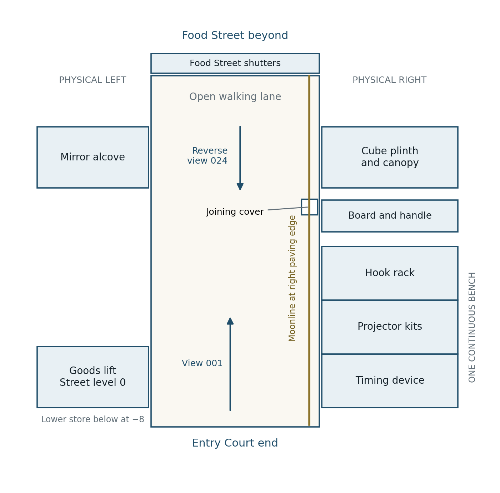

<!-- GENERATED by `python3 bg.py import` from CH01-LOCATION-IMAGE-GENERATION-DRAFT-02.docx. Edit the draft (or records-meta.json) and re-import. body-sha:eaf25da2c8db15ba -->
# Location Bible: ChandRush Chapter 01 (from Draft 02)

Imported verbatim from `CH01-LOCATION-IMAGE-GENERATION-DRAFT-02.docx`, apart from Markdown formatting. The draft is the authority; `README.md` lists the workflow decisions and known source issues.

**ChandRush Chapter 01Location Image Generation Draft**

**Draft 02   •   20 October 2026**

27 image records covering three main places and their essential working areas. Each record provides a complete generation prompt, exact visual state, reference dependencies and image checks. Additional everyday crops and small state changes are handled through reuse.

## Scope and use

Scope. Generate the 27 numbered image records only. They cover Lantern Street and its working areas, the Old Blue Gate exterior and the Food Street threshold. The separate prologue locations and later Food Street working views are outside this set. Location records describe environments and visual states; they contain no story scenes, dialogue or page assignments.

Sources. Spatial and equipment authority: CHANDRUSH-DETAILED-BOOK-WISE-STORY-V-16(4).docx. Chapter image requirements and more precise staging: CH01-INTEGRATED-MANUSCRIPT-V04(2).docx. V16 remains a working draft awaiting author review. The older location artwork informs the written style brief only and is not an image input.

Generation order. Work in ascending image-ID order. Validate Image 001 for style, geography and usable space before making its dependent views. Attach the actual accepted image files named in each record, using the stated reference role; filenames alone are not visual inputs. For a state edit, preserve the accepted source image and change only the described parts. Each ID produces one image. Reuse notes add no separate location jobs.

Framing and output. The preferred ratios describe reference images, not graphic-novel page layouts. Use the pixel targets in Workflow settings. Keep useful ground and wall margins around the main equipment so later character compositions can fit. Fine technical details must remain sharp. Avoid strong depth-of-field blur on task objects.

## Shared illustration style

Create a richly rendered, semi-realistic storybook environment illustration for ChandRush, an enchanted travelling fair. Use convincing perspective, softly painted surfaces and detailed timber grain, brushed brass, pale stone, glass and fabric. Blue-painted timber and indigo structural frames share restrained gold moon motifs. Warm amber work lamps illuminate useful surfaces; cool full-moon light edges roofs and distant forms. Give the environment depth, scale and craftsmanship, with clear silhouettes and uncluttered working space. Keep the relevant environment and mathematical details sharp; use only gentle atmospheric softening in the distance. Create one clean location image without characters, hands, dialogue, captions, callout arrows or watermarks. Print only the physical labels explicitly requested for this image.

## Continuity and generation rules

Permanent and movable content. Architecture, fixed lamps, benches, mounting points and equipment construction stay fixed. The numbered images include only the specified equipment and location props. Characters, hands, portable lamps, staff, bags and character reflections are added in page production. Include paper cards and the packing slip only where a numbered record explicitly requires them. The parked entrance cart, lower-store supply cart and Food Street obstructing cart are different objects; they must not be merged.

Exact content. Show exact counts only where the record calls for them. Distant quantities may be hidden or too small to read, but must not be visibly wrong. Treat physical labels as exact copy. If a generated grid, numeral or word is inaccurate, correct that region using a verified guide or precise lettering before accepting the image. Preserve the actual surface and perspective carrying the label.

Style and geometry references. A reference marked for style only controls rendering, materials and light. It must not transfer its buildings, equipment or layout into another location. A parent-location reference controls geography as well as appearance. Minor crops and small local edits use the closest accepted image; a large change in viewing direction uses the separately specified record.

Design choices. The sources fix the meaningful geography and equipment. This draft completes visual choices such as wall seams, brackets, compact controller layout, the bird’s short forward guide, stock-box placement and the V’s lower-right rim position. The first accepted render of each location fixes those choices for its later views. These details add no new location, mechanism, plot event or mathematical quantity.

## Image selection

The set includes major establishing views, the distinct lower-store and reverse viewpoints, deep equipment details and meaningful repair states. Paired states are made by editing their specified source image. A minor zoom, changed expression, moving hand, lamp switch or card swap does not create an additional location job.

Use the final section for reuse instructions. It is not an additional image queue. Teaching diagrams, calculation sheets and character insets retain the manuscript’s content and are produced separately from these location references.

## Fair geography

From the Entry Court end of Lantern Street, the goods lift is near-left and the long three-part workbench is right. The mirror is farther left, opposite the cube plinth on the right. The final control and the moonline joining cover belong to that cube area. Food Street opens beyond the far shutters. The Gate exterior is a separate place outside Entry Court; it is never a backdrop behind a Lantern Street task.

## Workflow settings

Create the same 27 reference images. This setup controls generation, reference use and checking; it adds no image jobs.

| Reference ratio | Target PNG dimensions |
|---|---|
| 16:9 | 3840 × 2160 pixels |
| 4:3 | 3600 × 2700 pixels |
| 3:2 | 3600 × 2400 pixels |

These are delivery targets, not claims about an image model’s native output. Generate at the largest supported native size in the requested ratio. If necessary, upscale proportionately and inspect fine detail again. Retain the native file. Never stretch an image or crop away required equipment to reach a target.

Master first. Check Image 001 against the written geography and style before using it as a reference. Check each new sublocation against its parent before creating its other states. Keep only the accepted version under the specified output filename.

Actual image inputs. Attach the accepted files listed under New references to that job. A filename typed in a prompt does not supply the image. Apply a style-only reference to finish and materials; apply a parent reference to geometry as well. Exclude the old location pack from all image inputs.

State priority. The current record’s Visual state and Generation prompt control the required state. A reference may establish construction while showing an earlier or later state. Match every visible neighbouring device, indicator, shutter and light to the current record.

Exact details. Check the 9 × 9 mirror, 4 × 4 × 4 cube, three lenses and five rings, numbered cards, labels and indicator order. Correct mistakes using a verified construction guide or precise lettering on the proper physical surface. Accept a state edit only when the unchanged geometry still matches its parent.

Job handoff. Pass the Output, New references, View, Visual state, complete Generation prompt and Image checks to each job. Save the accepted PNG under its exact CH01_LOC filename and record the reference files used. Reuse notes are later composition instructions, not additional generation requests.

Draft 02 changes. Removed the timing-bird instruction from unrelated prompts; changed Image 010’s timing reference to Image 009; protected earlier views from Image 021’s completed cube; added output targets, workflow settings and the geography guide. The 27 image IDs and location scope remain unchanged.

## Lantern Street geography guide

Overhead schematic for relative position and continuity. It is not to scale and does not prescribe exact distances, the lane’s curve, equipment dimensions or decorative design. Read physical left and right while looking from Entry Court towards Food Street.

The three bench sections share one bench. The mirror and cube face each other across the lane. In the reverse view, the physical right-side bench and moonline appear on screen-left. The Old Blue Gate lies outside this diagram, beyond Entry Court; its exterior is a separate location.

## Detailed location descriptions

These descriptions establish the connected places and fixed visual choices. The individual image records that follow repeat the information needed for their own prompts.

### Lantern Street

A broad pale-paved lane curves gently between blue-painted timber stall walls, crossed by tall indigo arches carrying lantern fittings. Looking from Entry Court towards Food Street, the goods lift occupies the near-left wall. One continuous pale workbench occupies the right wall: timing device at its entrance-side end, projector kits in its centre and hook rack at its farther end. The square mirror is farther along the left wall; the cube plinth stands directly opposite it on the right. The final indicator board and handle are on the cube plinth’s right when facing that wall. Food Street’s shutters close the far bend. A narrow silver moonline follows the physical right paving edge and passes the flat joining cover at the cube plinth.

Keep the lane spacious enough for a group of children and a handcart to pass. Timber panels, brass corner straps, a few indigo fabric valances and selected moon ornaments give it a travelling-fair character. Tall arches, repeated warm wall lamps and the bend create depth. Decorative detail belongs on frames and upper edges; the paving and working areas remain legible. Closed stall shutters are ordinary background frontage, not a numbered supply system.

Fixed anchors. Entry arch; near-left lift recess; continuous right-wall bench; far-left mirror alcove; opposite cube canopy; right-edge moonline; far Food Street shutters. In a reverse view, the bench and moonline appear screen-left and the mirror side screen-right.

### Goods lift bay and lower store

One guarded shaft is recessed into Lantern Street’s near-left blue wall. At street level, a brass sliding safety gate opens onto one lift car with a flat, cart-sized floor. The paving and car floor align at position 0. A blue-and-brass controller stands to the shaft’s right beneath one fixed warm wall lamp. Its upper part contains a numbered-card shelf and slots, START and HOLD controls, a small last-change window and CANCEL LAST CHANGE. A lower hinged cover conceals four equal gate-catch correction wheels; two red warning lamps sit above that cover. The five street-readiness indicators belong at the cube end, not on this controller.

Use simple blue timber cheeks, brushed-brass gate bars, two restrained guide rails and practical joinery. The lower store is a modest timber landing at −8 with its own guard and lamp. It has room for one supply cart to wait beside the car and turn onto it. Keep the shaft open enough for a steep view down to this landing. The upper control area stays compact and reachable from safe paving.

Fixed anchors. Street 0 threshold; controller to the shaft’s right; warm lamp above; brass gate bars; lower timber landing and −8 mark. Use a compact vertical position display beside the street guard, with equally spaced positive and negative values. This display reports the car position; it does not add rooms or storeys. The separate last-change window reports a movement.

### Timing area at the left end of the bench

The pale workbench’s entrance-side end holds one small carved bird on one short sliding platform. Facing the bench from the lane, the blue catch and blue lamp are left and the gold catch and gold lamp are right. Both catches restrain the same platform at its rear starting position. The platform moves a short distance towards the bench’s front edge and stops safely within its surface. A beat strip, start-card holder and small counter sit between or immediately behind the two catches without hiding them. The projector-kit area continues to the right.

Use a small handcrafted bird with a simple hinged bowing head, compact brushed-brass catches and a short straight guide. The device is a tabletop object. One warm lamp lights the pale bench and blue wall. Retain the same bench lip, brass corner strap and wall-panel seams in all views.

Fixed anchors. Blue catch left, gold catch right, one shared platform, short forward guide, pale bench front edge, blue wall, kit area to the right. The opening intervals remain four and six beats in every state. The start card changes from 6 to 12.

### Projector kit area at the centre of the bench

The centre of the same pale right-wall bench carries two stock boxes, padded kit boxes, one loose sample board and a short lantern-test rail fixed above. The lens stock box is left and the ring stock box right when facing this section. Leave a clear work area between them. The timing device remains farther left and the brass hook rack farther right. One padded sample kit is sufficient to establish the exact parts; the remaining kits can stay closed.

Give stock boxes blue timber sides, ivory padded interiors and brass corners. Put large physical stock labels on their front faces. Blue glass lenses have visible thickness and a polished edge; brass rings are separate complete circles. Keep the sample board a simple pale removable board, with no pre-cut three-and-five pattern in its empty state. The rail above has a plain mounting bracket rather than a preassembled solved head.

Fixed anchors. Continuous bench lip; left lens box; right ring box; blue wall; test rail above; timing fittings farther left; hook rack farther right. One kit contains three lenses and five rings. Three rings fit the lens rims and two fit the supports. These are eight parts, not eight lenses or five additional lenses.

### Sealed hook rack at the right end of the bench

A simple brass rack rises over the far-right end of the pale workbench against the blue wall. Four sealed cartons stand in one row. Facing the rack from the lane, their quantities are 348, 355, 414 and 525, in that order. Each carton has a clearly visible printed quantity beneath an intact transparent packing seal. One removable worker card is held by a brass clip above each position. The rack’s right upright and the pale bench lip identify the close views.

The carton faces are warm ivory with blue edges and neat sealed lids. The rack is compact enough for the four labels to be read together. Its clips are ordinary visible metal clips; avoid ornate structures that obscure their contact surfaces. The kit bench continues left. Fine black dust belongs beneath the third clip and on the contact edge of the original 25 WORKERS card.

Fixed anchors. Fixed carton order 348, 355, 414, 525; four original worker cards only; right brass upright; bench front edge; kit area left. Initial cards are 5, 4, 25, 9. Verified matching is 4, 5, 9, 25. The original 25 WORKERS card is removed as evidence, leaving its final rack position empty; no replacement card is added.

### Square mirror alcove

The far-left blue wall contains a shallow alcove opposite the cube plinth. A shallow square brass frame is mounted just above the paving, with a slight backward lean towards the open canopy gap. The reflective plane remains fixed across all views. The frame sits against the alcove, with a low supported lower edge and an upper edge within comfortable reach; it is not a floor opening. A warm lamp is mounted on the left. A padded tray and opaque tile crate sit inside the alcove’s side working space, clear of the lane.

Use a fine brushed-brass rim, restrained corner detailing and blue timber rear panels. A particular paving seam meets the frame’s lower-left support. Keep the lamp’s bracket, tray, crate and frame mounting identical between states. All 81 square tiles have the same size and remain unbroken. The completed surface is one flat nine-row, nine-column grid with fine seams. A continuous reflected full moon crosses the completed surface from the specified higher view.

Fixed anchors. Left warm lamp; blue rear wall; open canopy gap; lower-left paving seam; fixed leaning frame; tray and crate to the alcove’s right. For this draft, place the concealed V on the lower-right inner brass rim, facing the lane. That exact position is a visual design choice to retain across later images. Dust hides it in all unlit-street states.

### Cube plinth and final control

Opposite the mirror, a low square plinth stands beneath an indigo canopy against the right blue wall. It carries one square base, 64 small lantern cubes and one supported top frame. On the wall to the plinth’s right is one five-light control board and one large down-pull handle. The physical left-to-right indicator order is LIFT, RHYTHM, SUPPLIES, MIRROR, CUBE. One flat brass cover lies in the paving at the plinth’s front-right corner, over the narrow silver moonline.

Make the cubes equal translucent ivory lantern blocks with thin restrained brass edges, sufficiently distinct to count in a close view. The top frame is simple and supported at its corners, with accessible fastenings. The plinth remains low enough for children to steady the frame from the paving. Give the indigo canopy one recognisable front post and a plain valance. Leave a clear patch of blue wall beside the control and a clear working patch of paving around the floor cover.

Fixed anchors. Mirror directly opposite; indigo front canopy post; square plinth; board and down-pull handle to its right; separate flat floor cover at the plinth’s front-right corner; right-edge moonline. Four equal rows, columns and layers make the completed 64-cube block. All five readiness lamps can be white while the arches remain dark.

### Moonline joining recess

The moonline is a narrow silver light-carrying track inset along Lantern Street’s right paving edge. Its only joining recess in this image set is directly beneath the flat brass cover at the cube plinth’s front-right corner. Two ends of the same track enter a small shallow recess. Each end has a simple fastening tab and screw position. The existing screws secure those original ends when aligned. The fitting has no second control, hidden switch or separate power box.

Use a restrained fictional silver track and brushed-brass cover with ordinary tool-sized fastenings. The open recess remains shallow enough to reach from the paving. In the open views, lay the original cover flat immediately to the wall side, outside the walking route. Keep the plinth corner and one paving seam visible to establish scale and position.

Fixed anchors. Cube front-right corner; right paving edge; same two track ends and screws; same cover laid beside opening; canopy-post base beyond. The disconnected state has a visible gap and fine black dust in the screw holes. The connected state has aligned secured ends. Cover closure and illumination can be edited locally from these references.

### Old Blue Gate exterior waiting lane

Two enormous weathered blue timber door leaves stand between pale-stone piers at the end of a contemporary Mumbai pedestrian lane. Brushed-brass ribs and selected moon-shaped openings decorate the timber. One round full-moon ornament is mounted above the opening. Seen from outside, a small service door is built into the left leaf. A separate blue equipment door stands farther left beyond the left stone pier. A planter is to the left of the main opening and a bench to its right.

Use the fair’s blue timber, brass and indigo decorative accents against ordinary Mumbai buildings: plaster walls, balconies and restrained urban details. Keep a broad clear foreground for waiting visitors. Warm nearby lamps make the doorway and waiting area readable. The round ornament glows softly in this chapter’s required state. The timber main leaves remain fully closed. The sky moon, if included, is full.

Fixed anchors. Left-leaf service door; separate equipment door beyond left pier; left planter; right bench; round ornament above. The ornament is not the Moon Bell. The surrounding lane is recognisably contemporary Mumbai rather than a second elaborate fair street.

### Food Street threshold

Beyond Lantern Street’s raised terminal shutters is a covered lane under saffron and teal awnings. Looking into it from Lantern Street, the recipe and cooking counter is left and the jugs and juice urn are right. The near-left packing bench has a side door into Return Walk. A round loading table with two trays stands farther into the clear central lane. The distant opening leads towards the Parade Ground. Its geometry should remain available for the later Food Street location set.

Keep blue timber bases, brass details and pale paving continuous with the fair, while the layered saffron and teal cloth creates a different silhouette and colour rhythm. Cooking surfaces are behind the left counter. The left recipe board and serving controls are present but their small markings are not the focus of this threshold image. A separate cup trolley is parked at the packing end, sufficiently occluded that a false cup count is not shown.

Fixed anchors. Raised threshold shutters; left cooking counter; right drinks counter; near-left packing bench and side door; central two-tray table; far Parade opening. One crooked cart obstructs the entrance with one bowl trapped under a wheel, other fallen bowls nearby and a dosa overhanging a too-small plate on the left counter.
